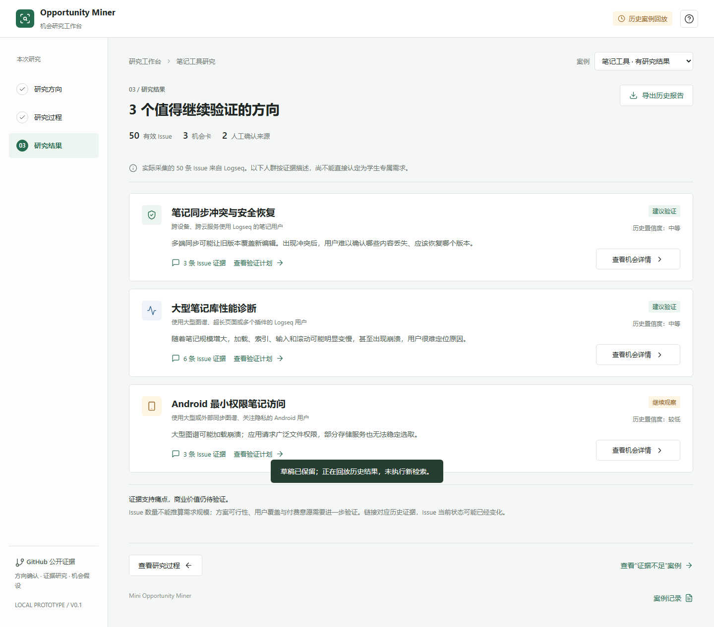
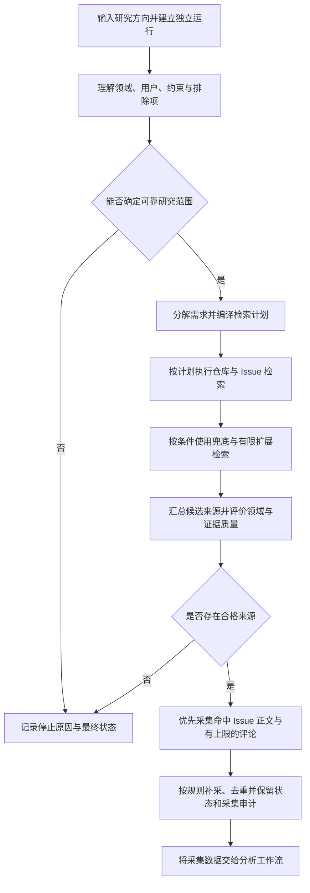
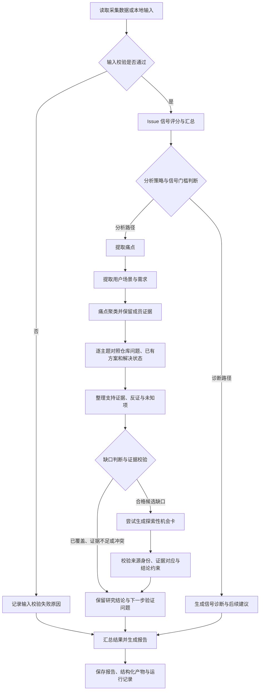

# Mini Opportunity Miner

**从 GitHub Issue 中发现有证据支持的产品机会假设。**

Mini Opportunity Miner 是面向独立开发者、Agent 开发者和小型产品团队的机会研究 Agent。用户输入一个研究方向，系统将其转化为有边界的检索任务，从 GitHub Issue 和评论中整理用户痛点、分析潜在切入点，并输出附带来源和下一步验证建议的机会卡。

项目希望缩短从“想探索一个方向”到“知道下一步应该验证什么问题”的距离。目前形态为本地运行的研究型 MVP，以及基于真实历史产物的可点击演示原型。

## 为什么做这个项目

在选择产品方向时，开发者需要把一个宽泛想法转化为具体的用户问题。GitHub 上有大量真实反馈，但从反馈到产品判断仍有几道障碍：

- **信息分散：** 问题描述、补充条件和已有解决方案分布在不同 Issue 与评论中。
- **信号混杂：** 缺陷、配置问题、功能请求和过时反馈同时存在，关键词命中不代表值得投入。
- **缺少决策依据：** 发现一个痛点后，还需要判断影响场景、现有替代方案和下一步验证方式。

本项目尝试把这段研究过程组织成可复核的工作流。上述用户需求是项目的定位假设，尚未通过规模化用户研究验证。

## 演示与输出

下载仓库后，用浏览器打开 [本地演示原型](prototype/index.html)，可查看研究方向、历史流程回放和机会卡详情，无需安装依赖或配置密钥。GitHub 文件页仅展示 HTML 源码，交互演示需下载后打开。

**原型展示历史结果，不调用实时后端。** 审批、暂停与恢复等交互属于历史流程演示，不代表当前默认自动执行的实时界面。

历史笔记工具案例 `my_real_note_test` 保存了 50 条有效 Issue、150 条评论正文，并生成 3 张机会卡。最终 Issue 全部来自 Logseq；这份样例不能代表对笔记工具市场或学生笔记场景的完整覆盖，也不能作为当前版本自主运行效果的证明。

机会研究结果主要帮助使用者回答：

| 问题 | 输出内容 |
| --- | --- |
| 用户在哪个场景遇到了什么困难？ | 痛点与场景归纳 |
| 判断依据是什么？ | 对应的 Issue 来源和证据 |
| 可以探索什么切入点？ | 机会假设与解决方向 |
| 还需要确认什么？ | 不确定性与后续验证建议 |



## 工作流程

> 版本说明：下图描述本地开发版的完整设计。当前 GitHub 主分支尚未包含场景提取与独立缺口分析节点；主分支现有路径为痛点提取 → 聚类 → 机会生成 → 校验。本次仅更新说明文档，未同步这些代码。


流程分为“研究准备与采集”和“证据分析与输出”两部分。检索、来源筛选与采集由执行入口及服务层组织；后续分析由 LangGraph 编排，并非所有步骤都属于同一张 LangGraph 图。

### 1. 研究准备与证据采集



检索不是固定的一次关键词搜索。执行器支持仓库检索、仓库内 Issue 检索、全局兜底和受预算限制的扩展，实际顺序与是否触发由检索计划和执行条件决定。候选来源数量不等于可采集来源数量，搜索命中数也不等于最终有效输入数。

### 2. 证据分析与结果输出



最重要的判断发生在**痛点聚类之后、机会卡生成之前**：共同痛点并不自动构成产品缺口。系统需要对照现有方案及其覆盖情况，保留反证和未知项，将主题判断为候选缺口、已覆盖、证据不足或证据冲突。只有通过校验的候选缺口进入机会卡生成；卡片还需满足来源与证据一致性等约束。

因此，一次分析可以输出有价值的研究结论而没有机会卡。本地开发版的缺口工作流在 mock 模式下也不会生成真实模型机会提案。分析策略 `auto` 按信号门槛分流，`diagnose` 直接走诊断，`generate` 强制进入分析路径但不绕过后续缺口与卡片校验。

上述为默认自动研究的业务流程。理解、检索、采集和分析阶段的错误会记录对应阶段与结束原因；流程图未逐一展开这些异常边。自动运行另输出 `execution_result.json`，区分运行已结束、研究信息不足和执行失败。本地数据入口直接进入第二部分，不执行在线发现与采集。

当前 v1.9 默认采用自动执行模式：提交一次需求后，系统完成范围理解、来源选择、采集与分析，返回结果或明确停止原因。需要调试人工审批流程时，可显式选择 `review` 模式。

## 关键设计

### 先确定研究范围，再执行检索

将自然语言需求拆成目标领域、目标用户、约束与排除项，生成检索边界。来源筛选同时考虑仓库的领域和产品背景，减少“文字相关、实际场景不相关”的结果进入分析。

### 让证据质量影响执行路径

工作流使用输入校验、信号评分和条件分支决定进入机会生成还是诊断。无合格来源、证据不足或执行错误都有对应的结束说明。评分属于程序规则，不能解释为市场需求的概率。

### 保留来源与运行记录

按运行组织检索、采集和分析产物，保留证据来源及自动／人工决策身份，支持复核和 Badcase 定位。历史人工辅助运行与新版自动运行分别记录，避免混合比较。

### 分开模型判断与程序控制

LLM 参与需求理解、痛点提取和机会归纳；程序负责结构校验、流程路由、预算约束和产物保存。LangGraph 将分析过程组织为带状态与分支的工作流。

## Badcase 与迭代

以下案例摘要来自项目已有的本地历史迭代记录（2026-10-07）。它们用于说明问题如何被发现和处理，不构成本次重新执行的评测结果。

| 案例 | 观察到的问题 | 采取的改动或定位 | 验证状态与剩余问题 |
| --- | --- | --- | --- |
| 检索结果偏离目标领域 | RAG 需求出现 browser/coding/workflow 来源；笔记需求命中课程或个人笔记仓库 | 增加领域相关性判断、产品仓库分类与噪声过滤 | 历史记录包含实现和回归覆盖；不能据此宣称跨领域检索问题已解决 |
| 搜索命中的 Issue 在采集中丢失 | 后续采集重新读取 open Issue 列表，没有直接消费原搜索命中的 URL | 优先采集已命中 URL，再补采；保留关闭状态和时间等信息 | 历史真实运行保留了原命中的 closed Issue 及 3 条评论正文；仅证明该局部链路行为 |
| 扩展查询存在但没有执行 | 已生成 fallback 查询，却未接入实际运行流程 | 将扩展检索接回执行链，保留检索 trace | 已有实现记录；没有成对评估时，不报告召回率提升 |
| 自动运行未找到可采集来源 | v1.9 NOTE-01 历史运行得到 5 个候选，但自动选择为 0 | 保留筛选门槛，输出 `no_eligible_sources` 和最终状态 | 运行已结束，但研究目标未完成；来源覆盖与筛选效果仍待进一步评估 |

这些案例推动项目从“能生成结果”逐步转向“能说明结果依据、失败位置和未完成事项”。当前仍需通过更多独立需求的人工审核，检验来源相关性与机会质量。

## 快速开始

以下命令在项目根目录执行。已有文档记录的本地验证环境为 Python 3.13。

### 1. 安装依赖

```powershell
python -m venv .venv
.\.venv\Scripts\Activate.ps1
python -m pip install -r requirements.txt
```

### 2. 运行离线样例

```powershell
python -m src.runner --run-id readme_demo_01 --input data/issues.json --mode mock --run-mode auto
```

查看 `outputs/runs/readme_demo_01/` 下的报告和结构化产物。`mock` 使用本地模拟模型，用于了解流程，不代表真实检索或模型效果。

### 3. 执行真实研究

复制配置模板，在本地 `.env` 中填写自己的模型 API 配置与 GitHub token：

```powershell
Copy-Item .env.example .env
python skills/github-opportunity-research/scripts/research.py --project . doctor
python skills/github-opportunity-research/scripts/research.py --project . start --query "我想找笔记工具的机会，重点关注跨设备同步。" --mode real
```

根据命令返回的运行位置，查看 `execution_result.json` 和 `report_zh.md`。真实模式需要网络及相应 API 访问权限，可能产生模型调用费用。不要将密钥提交到仓库。

自动模式中的 `partial` 表示本次运行已结束，但证据或信息不足；它不表示正在等待审批。重新研究应新建运行，保留旧结果。

## 技术栈与目录

| 技术 | 用途 |
| --- | --- |
| Python、LangGraph | 执行研究流程，管理状态与条件分支 |
| Pydantic | 定义结构化数据与校验规则 |
| OpenAI-compatible API | 调用模型完成语义理解与生成 |
| GitHub API | 检索来源并采集 Issue 与评论 |
| SQLite | 保存本地运行记录 |
| pytest | 验证流程、结构校验和异常分支 |

```text
src/          核心工作流、节点和服务
skills/       研究任务的命令入口
scripts/      数据下载与辅助处理
data/         样例及研究数据目录
tests/        自动化测试
prototype/    静态历史回放原型
docs/         产品设计、版本与 Badcase 记录
outputs/      本地运行生成的产物
```

## 验证与已知局限

可运行自动化测试检查实现行为：

```powershell
python -X utf8 -m pytest -q --tb=short
```

v1.9 更改记录记载了当时 `363 passed` 的离线测试结果。这是历史版本验证记录，不是本草稿编写时的重新测试，也不代表真实检索质量或商业价值已经验证。

- GitHub 反馈偏向开源软件使用者，不能代表整个市场。
- Issue 可能已经解决；有历史痛点不等于当前仍有市场缺口。
- 程序信号评分和机会卡数量不能代替人工质量评估。
- 当前尚未证明跨领域稳定效果，完整开发集与留出集评测仍未完成。
- 前端为静态历史回放，尚未连接实时研究后端。

## 后续计划

以下为后续工作方向，尚不作为已完成能力：

- 完成开发集与留出集的独立评测，分别记录自动执行和人工介入结果。
- 结合 Badcase 改进检索范围、来源筛选与证据覆盖，并用同口径运行验证效果。
- 完善机会卡的人工审核标准，检查证据是否支持结论与后续验证建议。

## 更多文档

- [演示原型的来源与边界](prototype/README.md)
- [人工评估标准](docs/evaluation/human_review_rubric_v0.1.md)
- [发布说明](docs/RELEASE_NOTES.md)
